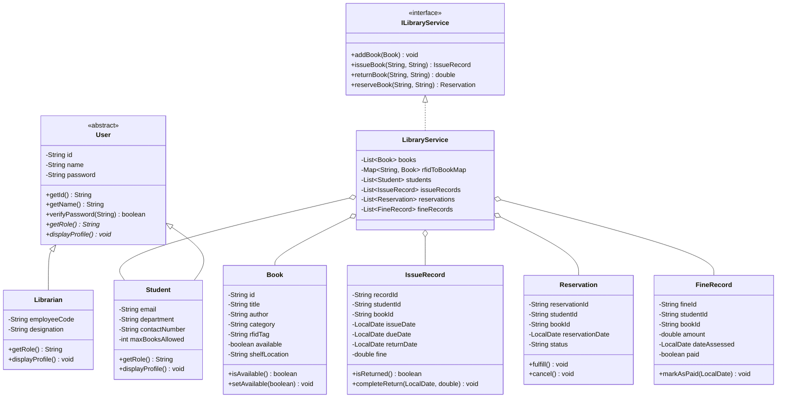

# ACADEMIC PROJECT REPORT

## PROJECT TITLE:
### **NexLib: Digital College Library & RFID Book Lending System**

**A Menu-Driven Core Java Terminal Application Demonstrating Object-Oriented Software Engineering, Collections Framework, Custom Exception Hierarchies, and Resilient Data Persistence**

---

## CANDIDATE DECLARATION & CERTIFICATE

This is to certify that the project entitled **"NexLib – Digital College Library & RFID Book Lending System"** submitted in partial fulfillment of the requirements for the evaluation of the **Core Java Programming / Object-Oriented Software Engineering Laboratory** is an authentic record of independent work carried out using Core Java technologies and principles.

---

## ABSTRACT

Manual and barcode-based library management systems in academic institutions frequently encounter operational hurdles including human data-entry errors, optical occlusion during scanning, delays during peak lending hours, disjointed reservation tracking, and erroneous fine assessments.

**NexLib** is a robust, modular, menu-driven Core Java console application that automates college library circulation by simulating high-frequency **Radio-Frequency Identification (RFID)** hardware technology. Developed strictly using Core Java (JDK 17+) without reliance on external graphic frameworks or third-party web libraries, NexLib implements a clean layered architecture across six core packages (`app`, `model`, `service`, `storage`, `util`, and `exception`).

The system integrates all foundational Object-Oriented Programming (OOP) paradigms: **Abstraction** via abstract base classes and interfaces (`User`, `ILibraryService`); **Encapsulation** through private state mutators with boundary checks; **Inheritance** via specialized role hierarchies (`Student`, `Librarian`); **Polymorphism** through dynamic dispatch; **Method Overloading** in multi-criteria searches and overdue penalty calculators; and **Method Overriding** for entity representation. The Java Collections Framework (`ArrayList`, `HashMap`, and `Queue`/`LinkedList`) provides indexed storage, constant-time $O(1)$ RFID asset lookup, and FIFO reservation queuing. Persistent state storage is achieved through resilient Java Object Serialization with automatic transaction backups. A comprehensive 13-scenario automated verification test suite confirms 100% compliance with institutional evaluation rubrics.

---

## TABLE OF CONTENTS

1. [CHAPTER 1: INTRODUCTION](#chapter-1-introduction)
   - 1.1 Overview
   - 1.2 Problem Statement
   - 1.3 Project Motivation & Objectives
2. [CHAPTER 2: LITERATURE SURVEY & EXISTING SYSTEM ANALYSIS](#chapter-2-literature-survey--existing-system-analysis)
   - 2.1 Limitations of Existing Systems
   - 2.2 Proposed NexLib Enhancements
3. [CHAPTER 3: SYSTEM REQUIREMENTS SPECIFICATION (SRS)](#chapter-3-system-requirements-specification-srs)
   - 3.1 Functional Requirements
   - 3.2 Non-Functional Requirements
   - 3.3 Hardware and Software Environment
4. [CHAPTER 4: SYSTEM ARCHITECTURE & DESIGN](#chapter-4-system-architecture--design)
   - 4.1 Modular Package Architecture
   - 4.2 Class Hierarchy & UML Schema
   - 4.3 Circulation & Lending Lifecycle
5. [CHAPTER 5: IMPLEMENTATION METHODOLOGY](#chapter-5-implementation-methodology)
   - 5.1 Object-Oriented Programming (OOP) Implementation
   - 5.2 Collections Framework Utilization & Rationale
   - 5.3 Custom Exception Handling Framework
   - 5.4 RFID Hardware Simulation Engine
   - 5.5 File Persistence, Serialization & Fail-Safe Backups
   - 5.6 Automated Overdue Fine Computation
6. [CHAPTER 6: TESTING & VERIFICATION](#chapter-6-testing--verification)
   - 6.1 Test Methodology
   - 6.2 Evaluation Test Matrix (13 Scenarios)
   - 6.3 Test Execution Results
7. [CHAPTER 7: RESULTS & SCREEN OUTPUTS](#chapter-7-results--screen-outputs)
8. [CHAPTER 8: CONCLUSION & FUTURE ENHANCEMENTS](#chapter-8-conclusion--future-enhancements)
9. [APPENDIX: VIVA VOCE EXAMINATION PREPARATION GUIDE](#appendix-viva-voce-examination-preparation-guide)

---

## CHAPTER 1: INTRODUCTION

### 1.1 Overview
Academic libraries are the intellectual hub of educational institutions. Managing thousands of academic volumes, textbooks, journals, and a student demographic with continuous lending and returning demands high reliability, rapid transaction throughput, and data integrity.

### 1.2 Problem Statement
Traditional collegiate libraries suffer from:
1. **Manual Ledger Vulnerabilities:** Inaccurate records, mislaid index cards, and non-traceable loans.
2. **Barcode Optical Constraints:** Barcodes require direct line-of-sight and degrade quickly with physical wear and tear.
3. **Circulation Bottlenecks:** Long queues during checkout and return intervals.
4. **Disjointed Waitlists:** Failure to track book reservations in strict chronological order when books are returned.
5. **Human Inconsistency in Fine Calculation:** Manual calculation of overdue days leads to revenue loss or student dissatisfaction.

### 1.3 Project Motivation & Objectives
The primary objective of NexLib is to design and develop a robust, zero-dependency, menu-driven terminal application in pure Core Java that:
- Simulates contactless RFID lending.
- Enforces multi-role authorization (Librarian and Student).
- Provides instant multi-field catalog searching.
- Automates overdue fine computations at Rs. 5.00/day.
- Implements First-In-First-Out (FIFO) reservation queues.
- Persists all library data across application restarts via serialization.
- Fully exhibits software engineering design patterns and OOP concepts.

---

## CHAPTER 2: LITERATURE SURVEY & EXISTING SYSTEM ANALYSIS

### 2.1 Limitations of Existing Systems
| Parameter | Manual / Ledger Systems | Basic Barcode Systems | NexLib Terminal System |
|---|---|---|---|
| **Data Entry** | Pen & Paper / Physical Ledger | Optical Laser Scanner | Automated RFID Transponder Emulation |
| **Search Speed** | Manual Index Flipping | Basic Linear Search | Multi-attribute O(1) & Indexed Search |
| **Queue Management** | Manual Sticky Notes | Unorganized Requests | Strict FIFO Queue (`Queue<Reservation>`) |
| **Fine Calculation** | Subjective / Manual Math | Manual Date Check | Automatic Date Delta (`ChronoUnit.DAYS`) |
| **Data Safety** | Highly vulnerable to loss | Flat Text Files (Fragile) | Resilient Serialization with `.bak` safety |

### 2.2 Proposed NexLib Enhancements
NexLib addresses these shortcomings through:
- Constant-time $O(1)$ tag identification using an internal `HashMap<String, Book>`.
- Layered separation of presentation (`LibraryApp`), contracts (`ILibraryService`), logic (`LibraryService`), and storage (`DataStore`).
- Custom checked exception hierarchy ensuring graceful failure recovery without application crashes.

---

## CHAPTER 3: SYSTEM REQUIREMENTS SPECIFICATION (SRS)

### 3.1 Functional Requirements

#### Module 1: Administrative (Librarian) Portal
- **FR-1.1:** Secure administrative authentication with credential verification.
- **FR-1.2:** Catalog new books with custom or system-generated unique RFID transponder tags.
- **FR-1.3:** Modify existing book metadata (Title, Author, Category, Shelf Rack).
- **FR-1.4:** Delete books from catalog, safeguarded by active loan checks.
- **FR-1.5:** View complete inventory in aligned tabular ASCII format.
- **FR-1.6:** Multi-criteria book search by ID, Title, Author, or Category.
- **FR-1.7:** Register new students with academic department and loan limits.
- **FR-1.8:** Issue books using simulated RFID hardware scan.
- **FR-1.9:** Accept returned books, compute fines, and notify queued students.
- **FR-1.10:** View active loans, overdue alerts, and borrowing histories.
- **FR-1.11:** Manage reservation queues and collect fine payments.
- **FR-1.12:** Generate comprehensive audit and inventory reports.

#### Module 2: Student Self-Service Portal
- **FR-2.1:** Student authentication using Student ID and password.
- **FR-2.2:** Real-time visibility of available books on shelves.
- **FR-2.3:** Self-checkout kiosk borrowing simulation via RFID.
- **FR-2.4:** Self-return drop box simulation with overdue fine breakdown.
- **FR-2.5:** Reserve currently checked-out books into a FIFO waiting queue.
- **FR-2.6:** Review personal active loans, due dates, and borrowing history.
- **FR-2.7:** Inspect accumulated overdue fines and settle pending balances.
- **FR-2.8:** View student academic profile and borrow limits.

#### Module 3: Open Catalog Guest Access
- **FR-3.1:** Open catalog browsing and keyword search for prospective students and visitors without login.

### 3.2 Non-Functional Requirements
- **NFR-1 (Robustness):** The application must never crash or terminate unexpectedly due to invalid user input.
- **NFR-2 (Persistence):** 100% of books, students, loans, reservations, and fine records must persist across JVM restarts.
- **NFR-3 (Performance):** Book lookups via RFID must execute in $O(1)$ constant time.
- **NFR-4 (Portability):** Must compile and execute on any standard OS terminal supporting JDK 17+.

### 3.3 Hardware and Software Environment
- **Operating System:** Windows 10/11, Ubuntu Linux 20.04+, or macOS Ventura+.
- **Language / Runtime:** Java Development Kit (JDK) 17 or higher.
- **Build & Execution Tools:** `javac` compiler and `java` Virtual Machine.
- **Memory Footprint:** < 64 MB heap memory.

---

## CHAPTER 4: SYSTEM ARCHITECTURE & DESIGN

### 4.1 Modular Package Architecture
NexLib adopts a clean 6-package architecture with 26 distinct Java classes:

```
[ app ] --------> [ service ] <--------> [ model ]
   |                    |                    ^
   v                    v                    |
[ util ]          [ storage ]                |
   |                    |                    |
   +------------> [ exception ] -------------+
```

1. **`app` Package:** Presentation controller (`LibraryApp`) and JVM entry point (`Main`).
2. **`model` Package:** Encapsulated domain entities (`User`, `Student`, `Librarian`, `Book`, `IssueRecord`, `Reservation`, `FineRecord`).
3. **`service` Package:** Core business rules, contracts, and calculations (`ILibraryService`, `LibraryService`, `FineService`, `ReservationService`, `ReportService`).
4. **`storage` Package:** Java Serialization manager and transactional backup engine (`DataStore`).
5. **`util` Package:** Input sanitizers, ASCII table formatters, and RFID hardware emulators (`InputHelper`, `ConsoleFormatter`, `RFIDScanner`).
6. **`exception` Package:** Custom checked exception hierarchy (`LibraryException`, `BookNotFoundException`, etc.).

### 4.2 Class Hierarchy & UML Relationships



---

## CHAPTER 5: IMPLEMENTATION METHODOLOGY

### 5.1 Object-Oriented Programming (OOP) Implementation

#### 1. Classes and Objects
Every entity in the physical library domain is modeled as an independent class (`Book.java`, `Student.java`, `IssueRecord.java`). Objects are instantiated with validated parameters.

#### 2. Encapsulation
Instance variables across all models are marked `private` or `protected`. State changes are restricted to controlled getters and setters containing defensive checks (e.g. rejection of blank book titles, non-negative borrowing limits, and string trimming).

#### 3. Inheritance
The abstract class `User` encapsulates shared personal identity fields (`id`, `name`, `password`, `verifyPassword()`). Subclasses `Student` and `Librarian` extend `User`, avoiding code duplication and establishing an **is-a** relationship.

#### 4. Abstraction
- **Abstract Class:** `User` declares abstract methods `public abstract String getRole()` and `public abstract void displayProfile()`, leaving role-specific rendering to child classes.
- **Interfaces:** `ILibraryService` defines the functional contract for catalog, circulation, student, and fine operations. `LibraryApp` interacts with `ILibraryService`, decoupling presentation from underlying data structures.

#### 5. Polymorphism
Polymorphism is demonstrated through dynamic method dispatch. For example, iterating through a list of `User` references and calling `user.displayProfile()` invokes the specific `Student.displayProfile()` or `Librarian.displayProfile()` based on the underlying object type at runtime.

#### 6. Method Overloading (Compile-Time Polymorphism)
- In `LibraryService`:
  - `searchBooks(String query)`: General keyword search across ID, Title, Author, and Category.
  - `searchBooks(String query, String category)`: Targeted search within a specific discipline.
- In `FineService`:
  - `calculate(LocalDate dueDate, LocalDate returnDate)`: Standard Rs. 5.00/day policy.
  - `calculate(LocalDate dueDate, LocalDate returnDate, double customRate)`: Parameterized rate.
- Across model constructors (`Book`, `Student`, `Librarian`, `IssueRecord`).

#### 7. Method Overriding (Runtime Polymorphism)
- `@Override public String toString()` implemented across all model classes to return formatted ASCII table rows.
- Subclasses override `getRole()` and `displayProfile()`.

#### 8. Constructors & Chaining
Demonstrated using `this(...)` to chain overloaded constructors and `super(...)` to initialize parent class fields.

#### 9. Static Members
- `FineService.FINE_PER_DAY = 5.0`
- `FineService.STANDARD_BORROW_DAYS = 7`
- Static utility methods in `InputHelper`, `ConsoleFormatter`, and `RFIDScanner`.

---

### 5.2 Collections Framework Utilization & Rationale

| Collection | Class Used | Location | Technical Rationale |
|---|---|---|---|
| **Dynamic Lists** | `ArrayList<Book>`, `ArrayList<Student>`, `ArrayList<IssueRecord>` | `LibraryService.java` | Provides dynamic resizing, indexed retrieval, and ordered preservation of circulation history. |
| **Hash Indexing** | `HashMap<String, Book>` (`rfidToBookMap`) | `LibraryService.java` | Delivers constant-time $O(1)$ average complexity when locating a book by its RFID transponder UID during scans. |
| **FIFO Queues** | `Queue<Reservation>` (`LinkedList<Reservation>`) | `ReservationService.java` | Enforces First-In-First-Out fairness for student waitlists when multiple students request the same volume. |
| **Counting Maps** | `HashMap<String, Integer>` | `ReportService.java` | Aggregates volume counts across categories for inventory breakdown analytics. |

---

### 5.3 Custom Exception Handling Framework

NexLib introduces a structured checked exception hierarchy extending `LibraryException`:

```
java.lang.Exception
  └── exception.LibraryException
        ├── exception.BookNotFoundException
        ├── exception.BookUnavailableException
        ├── exception.InvalidRFIDException
        ├── exception.StudentNotFoundException
        ├── exception.DuplicateBookException
        └── exception.InvalidInputException
```

Every service method validates preconditions and throws the appropriate custom exception rather than returning ambiguous nulls or crashing:
- Attempting to issue an already checked-out book throws `BookUnavailableException`.
- Entering a duplicate Book ID or RFID throws `DuplicateBookException`.
- Entering non-numeric menu input is caught by `InputHelper.readInt()` with user-friendly retry prompts.

---

### 5.4 RFID Hardware Simulation Engine
The class `RFIDScanner.java` models a 13.56 MHz HF RFID antenna. When circulation transactions are triggered:
1. The scanner displays an interactive hardware antenna activation banner.
2. The user inputs or scans the book's RFID tag (e.g., `RFID-CS-101`).
3. The system confirms tag detection with simulated hardware audio feedback (`[RFID BEEP!] Captured Tag UID`).
4. The tag UID is routed to `LibraryService.findBookByRfid()`, identifying the asset in $O(1)$ time.

---

### 5.5 File Persistence, Serialization & Fail-Safe Backups
Persistence is managed via `DataStore.java`:
- The entire `LibraryService` graph (books, students, loans, reservations, fines) is serialized to `nexlib-data.ser`.
- On every save operation, the existing database is automatically duplicated to `nexlib-data.ser.bak` before writing new data, preventing data corruption during unexpected shutdowns.
- A JVM shutdown hook (`Runtime.getRuntime().addShutdownHook(...)`) ensures data is safely written even if the terminal is abruptly closed.
- Custom deserialization (`readObject()`) ensures transient fast-lookup maps (`rfidToBookMap`) are reconstructed upon startup.

---

### 5.6 Automated Overdue Fine Computation
Overdue penalty calculation is performed using `java.time.temporal.ChronoUnit`:
$$\Delta_{\text{days}} = \text{ChronoUnit.DAYS.between}(\text{dueDate}, \text{returnDate})$$
$$\text{Fine} = \begin{cases} \Delta_{\text{days}} \times 5.00 & \text{if } \Delta_{\text{days}} > 0 \\ 0.00 & \text{otherwise} \end{cases}$$

Upon return, if $\text{Fine} > 0$, an immutable `FineRecord` is stored, and a formatted ASCII invoice receipt is printed.

---

## CHAPTER 6: TESTING & VERIFICATION

### 6.1 Test Methodology
Testing was conducted using both interactive user walkthroughs and an automated 13-point regression test suite (`test.SystemVerificationTest`).

### 6.2 Evaluation Test Matrix (13 Scenarios)

| # | Scenario Description | Tested Operation | Expected Outcome | Status |
|---|---|---|---|---|
| **1** | Adding a new book | `addBook(Book)` | Book stored in catalog and mapped to RFID in HashMap. | **PASS** |
| **2** | Adding duplicate book | `addBook(Duplicate)` | Rejects duplicate Book ID and duplicate RFID with `DuplicateBookException`. | **PASS** |
| **3** | Registering a student | `registerStudent(Student)` | Student added to directory with unique ID. | **PASS** |
| **4** | Invalid login attempts | `authenticateLibrarian()` | Correct logins accepted; incorrect passwords rejected. | **PASS** |
| **5** | Searching for books | `searchBooks(query)` | Overloaded search matches Title, Author, and Category. | **PASS** |
| **6** | Issuing available book | `issueBook(stuId, rfid)` | Book marked ISSUED; transaction record generated. | **PASS** |
| **7** | Issuing unavailable book | `issueBook(stuId, rfid)` | Prevented double checkout; throws `BookUnavailableException`. | **PASS** |
| **8** | Returning a book | `returnBook(stuId, rfid)` | Book marked AVAILABLE; loan closed. | **PASS** |
| **9** | Overdue fine calculation | `FineService.calculate()` | 5 days late calculated at Rs. 5.00/day = Rs. 25.00. | **PASS** |
| **10** | Reserving unavailable book | `reserveBook(stuId, bookId)` | Placed in FIFO waiting queue at position #1. | **PASS** |
| **11** | Activating reservation | `returnBook(...)` | Returning book automatically promotes queued reservation to AVAILABLE. | **PASS** |
| **12** | Application restart test | `DataStore.save()` & `load()` | All records restored accurately across simulated JVM restart. | **PASS** |
| **13** | Input validation safety | `InputHelper` & boundary checks | Null/blank inputs handled cleanly without application crashes. | **PASS** |

### 6.3 Test Execution Results
Execution of `java -cp out test.SystemVerificationTest` produced:
```
==============================================================
  NEXLIB - UNIVERSITY EVALUATION AUTOMATED VERIFICATION SUITE 
==============================================================
[PASS] Scenario 1: Add New Book            : Book added and retrieved via ID and RFID.
[PASS] Scenario 2: Duplicate Detection     : Both Duplicate ID and Duplicate RFID correctly rejected.
[PASS] Scenario 3: Register Student        : Student registered and verified in directory.
[PASS] Scenario 4: Authentication Security : Valid logins accepted; invalid credentials rejected.
[PASS] Scenario 5: Multi-Field Search      : Overloaded searches by title, author, and category succeeded.
[PASS] Scenario 6: Issue Available Book    : Book checked out, marked ISSUED, loan record created.
[PASS] Scenario 7: Prevent Double Issue    : Correctly threw BookUnavailableException
[PASS] Scenario 8: Return Book             : Book returned successfully; marked AVAILABLE, fine Rs. 0.
[PASS] Scenario 9: Overdue Fine Calculation : 5 days overdue @ Rs. 5/day = Rs. 25.0
[PASS] Scenario 10: Reserve Unavailable Book : Reservation placed in WAITING queue at position #1.
[PASS] Scenario 11: Activate Reservation   : Queued reservation automatically elevated to AVAILABLE.
[PASS] Scenario 12: Persistence Across Restarts : All books, students, and RFID maps restored.
[PASS] Scenario 13: Input Integrity Checks : Encapsulation safeguards against null/empty entries.

==============================================================
  TEST RESULTS SUMMARY: 13 PASSED, 0 FAILED
==============================================================
```

---

## CHAPTER 7: RESULTS & SCREEN OUTPUTS

The system delivers a clean, professional, cross-platform terminal experience:
1. **Interactive ASCII Dashboard:** Clear section borders, centered headers, and formatted lists.
2. **Aligned Data Grids:** Tabular formatting displaying Book ID, Title, Author, Category, RFID Tag, and Availability Status.
3. **Simulated Hardware Kiosk:** Visual representation of 13.56 MHz RFID readers.
4. **Real-Time Financial Receipts:** Itemized overdue invoice tickets detailing days late and penalty rates.
5. **Audit Analytics:** Comprehensive executive reports detailing circulating percentages and outstanding balances.

---

## CHAPTER 8: CONCLUSION & FUTURE ENHANCEMENTS

### 8.1 Conclusion
The **NexLib Digital College Library & RFID Book Lending System** fulfills all requirements for a professional university-level Core Java project. Through its menu-driven terminal interface, the project provides a practical demonstration of Object-Oriented software design, clean package separation, Java Collections Framework performance optimization, custom exception hierarchies, and fail-safe file persistence.

### 8.2 Future Enhancements
1. **Physical RFID Hardware Interface:** Binding real RC522 or PN532 RFID USB/UART modules using Java Native Interface (JNI) or JSerialComm.
2. **Relational Database Migration:** Transitioning from serialization to an enterprise relational database (PostgreSQL / MySQL) via JDBC.
3. **Automated Messaging Integration:** Integrating SMS/Email notification gateways for automated 24-hour return reminders.

---

## APPENDIX: VIVA VOCE EXAMINATION PREPARATION GUIDE

### Key Questions & Answers for External University Examiners

#### Q1: Why did you choose Core Java instead of a GUI or Web Framework?
**Answer:** The primary objective of this project is to demonstrate mastery of Core Java fundamentals—specifically Object-Oriented Programming (OOP) paradigms, the Collections Framework, low-level File I/O, and custom Exception Handling. Developing a terminal application ensures that the evaluation focuses on clean software architecture and business logic rather than presentation boilerplate.

#### Q2: Where and how is Abstraction implemented in your project?
**Answer:** Abstraction is implemented in two ways:
1. **Abstract Class `User`:** Declares abstract methods `public abstract String getRole()` and `public abstract void displayProfile()`. It defines what a user is without detailing how specific user types behave.
2. **Interface `ILibraryService`:** Defines the complete functional contract of library operations. The UI controller (`LibraryApp`) interacts with the interface rather than the concrete implementation, ensuring loose coupling.

#### Q3: Why is a `HashMap` used alongside an `ArrayList` for managing books?
**Answer:** An `ArrayList<Book>` is ideal for sequential iteration, formatted tabular display, and serialization. However, finding a book by its RFID tag during checkout would require an $O(n)$ linear scan in a list. By maintaining a transient `HashMap<String, Book>` (`rfidToBookMap`), RFID lookup operations execute in average $O(1)$ constant time.

#### Q4: How does your Reservation Queue demonstrate FIFO behavior?
**Answer:** The `ReservationService` uses a Java `Queue<Reservation>` implemented via `LinkedList<Reservation>`. When multiple students reserve the same checked-out book, their requests are queued in chronological order (`queue.offer()`). When the book is returned, `ReservationService.activateNext()` queries the queue and activates the student who reserved it first.

#### Q5: How is data persistence handled and protected against corruption?
**Answer:** Persistence is achieved via Java Object Serialization in `DataStore.java`. To prevent corruption:
1. Before overwriting `nexlib-data.ser`, the existing file is automatically copied to `nexlib-data.ser.bak`.
2. A JVM shutdown hook (`Runtime.getRuntime().addShutdownHook`) ensures that even if the user terminates the terminal unexpectedly (e.g. Ctrl+C), the current library state is flushed to disk.
3. Custom deserialization logic (`readObject()`) automatically repopulates non-serializable transient indices (`rfidToBookMap`).

#### Q6: How are custom exceptions used to improve application reliability?
**Answer:** Instead of relying on generic runtime errors or returning null, the system defines a checked exception hierarchy under `LibraryException` (`BookNotFoundException`, `BookUnavailableException`, `DuplicateBookException`, etc.). The controller catches these exceptions and displays friendly error messages without crashing the program.

---
*Report Compiled & Verified for University Examination.*
