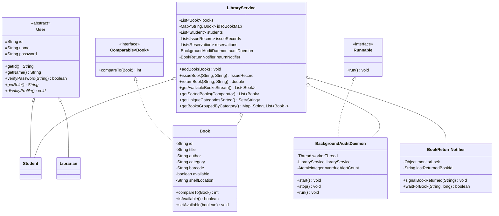

# ACADEMIC PROJECT REPORT

## PROJECT TITLE:
### **NexLib: Digital College Library Management System**

**A Menu-Driven Core Java Console Application Demonstrating Object-Oriented Software Engineering, Collections Framework, Multithreading & Synchronization, Stream API, Generics, and Character/Byte Stream File Handling**

*Submitted in partial fulfillment of the academic requirements for the Continuous Assessment 3 (CA-3) Project Milestone in Programming in Java (Course Plan Lectures 13–54) at Chitkara University.*

---

## CANDIDATE DECLARATION & CERTIFICATE

This is to certify that the project entitled **"NexLib – Digital College Library Management System"** submitted in partial fulfillment of the requirements for the evaluation of **Programming in Java (Course Code: 25CSE0202)** at **Chitkara University** is an authentic record of independent work carried out strictly using Core Java technologies and principles in conformance with the university course plan.

---

## ABSTRACT

Manual and outdated library management systems in academic institutions frequently encounter operational hurdles including human data-entry errors, circulation delays during peak lending hours, disjointed reservation tracking, and inaccurate overdue fine assessments.

**NexLib** is a robust, modular, menu-driven Core Java console application that automates college library circulation and administration. Developed strictly using pure Core Java (JDK 17+) without reliance on external frameworks or third-party web libraries, NexLib implements a clean layered architecture across seven core packages (`app`, `model`, `service`, `storage`, `util`, `exception`, and `test`).

The system integrates all foundational topics taught across Lectures 13 to 54 of the Chitkara University Course Plan across exactly 20 basic, modular files organized in 7 standard packages:
1. **Object-Oriented Programming (OOP) Paradigms:** **Abstraction** via abstract base classes (`User`); **Encapsulation** through private state mutators with boundary checks; **Inheritance** via specialized role hierarchies (`Student`, `Librarian`); **Polymorphism** through dynamic dispatch; **Method Overloading** in multi-criteria searches; and **Method Overriding** for entity representation.
2. **Collections Framework & Sorting (Lectures 16–25):** `ArrayList` for dynamic records, `HashMap` for constant-time $O(1)$ Book ID indexing, `Queue`/`LinkedList` for FIFO reservation queues, `TreeSet` for alphabetically sorted categories, `HashSet` for distinct active borrower tracking, `TreeMap` for category-grouped catalog indexing, `Iterator`/`ListIterator` for safe traversal, `Comparable<Book>` for natural sorting, and custom `Comparator` strategies (`BY_TITLE`, `BY_AUTHOR`, `BY_CATEGORY`).
3. **Multithreading & Concurrency (Lectures 26–33):** Background daemon thread (`BackgroundAuditDaemon`) performing periodic overdue audits using `Thread.sleep()`, thread lifecycle tracking (`NEW`, `RUNNABLE`, `TIMED_WAITING`, `TERMINATED`), synchronization locks, and inter-thread producer-consumer monitor coordination using `wait()` and `notifyAll()` (`BookReturnNotifier`).
4. **Stream API & Introductory Generics (Lectures 43–48):** Declarative functional pipelines using `filter()`, `map()`, `sorted()`, `distinct()`, `limit()`, method references, and a generic container `DataResult<T>` with bounded wildcards `<? extends E>`.
5. **Character & Byte Stream File Handling (Lectures 49–54):** Character streams (`FileReader`, `FileWriter`, `BufferedReader`, `BufferedWriter`) for human-readable CSV catalog export/import and text audit logs; Byte streams (`FileInputStream`, `FileOutputStream`) for resilient Java Object Serialization (`DataStore`) with automatic `.bak` backups.
6. **Automated Verification Suite:** A comprehensive 13-point automated verification test suite (`SystemVerificationTest.java`) confirming 100% compliance with institutional evaluation rubrics.

---

## TABLE OF CONTENTS

1. [CHAPTER 1: INTRODUCTION](#chapter-1-introduction)
   - 1.1 Overview
   - 1.2 Problem Statement
   - 1.3 Project Motivation & Objectives
2. [CHAPTER 2: LITERATURE SURVEY & EXISTING SYSTEM ANALYSIS](#chapter-2-literature-survey--existing-system-analysis)
   - 2.1 Limitations of Existing Systems
   - 2.2 Proposed NexLib Enhancements
3. [CHAPTER 3: SYSTEM REQUIREMENTS SPECIFICATION (SRS)](#chapter-3-system-requirements-specification-srs)
   - 3.1 Functional Requirements
   - 3.2 Non-Functional Requirements
   - 3.3 Hardware and Software Environment
4. [CHAPTER 4: SYSTEM ARCHITECTURE & DESIGN](#chapter-4-system-architecture--design)
   - 4.1 Modular Package Architecture
   - 4.2 Class Hierarchy & UML Schema
   - 4.3 Circulation & Lending Lifecycle
5. [CHAPTER 5: IMPLEMENTATION METHODOLOGY](#chapter-5-implementation-methodology)
   - 5.1 Object-Oriented Programming (OOP) Implementation
   - 5.2 Collections Framework, Sorting & Iterators (Lectures 16–25)
   - 5.3 Custom Exception Handling Framework (Lectures 13–15)
   - 5.4 Multithreading, Daemon Threads & Inter-Thread Coordination (Lectures 26–33)
   - 5.5 Stream API Pipelines & Introductory Generics (Lectures 43–48)
   - 5.6 File Handling: Character Streams (CSV) & Byte Streams (Lectures 49–54)
   - 5.7 Automated Overdue Fine Computation
6. [CHAPTER 6: TESTING & VERIFICATION](#chapter-6-testing--verification)
   - 6.1 Test Methodology
   - 6.2 Evaluation Test Matrix (13 Scenarios)
   - 6.3 Test Execution Results
7. [CHAPTER 7: RESULTS & SCREEN OUTPUTS](#chapter-7-results--screen-outputs)
8. [CHAPTER 8: CONCLUSION & FUTURE ENHANCEMENTS](#chapter-8-conclusion--future-enhancements)
9. [APPENDIX: VIVA VOCE EXAMINATION PREPARATION GUIDE](#appendix-viva-voce-examination-preparation-guide)

---

## CHAPTER 1: INTRODUCTION

### 1.1 Overview
Academic libraries serve as the knowledge repository of educational institutions. Managing book catalogs, multi-disciplinary volumes, registered student demographics, and continuous borrowing/returns demands computational accuracy, transaction safety, and persistent record integrity.

### 1.2 Problem Statement
Collegiate libraries frequently encounter:
1. **Manual Ledger Vulnerabilities:** Lost index cards, unrecorded loans, and human transcription errors.
2. **Circulation Bottlenecks:** Delays during checkout and check-in intervals.
3. **Disjointed Waitlists:** Inability to maintain fair FIFO waiting queues for high-demand textbooks.
4. **Human Inconsistency in Fine Calculation:** Manual date counting leads to calculation errors or disputes.
5. **Lack of Concurrency:** Inability to run periodic audit routines without interrupting student circulation.

### 1.3 Project Motivation & Objectives
The primary objective of NexLib is to develop a modular, zero-dependency console application in standard Core Java aligning directly with Chitkara University's syllabus:
- Enforce role-based access control (Librarians and Students).
- Deliver constant-time $O(1)$ book lookups via `HashMap`.
- Implement natural and multi-strategy sorting using `Comparable` and `Comparator`.
- Automate overdue fine calculations at Rs. 5.00/day using `java.time.temporal.ChronoUnit`.
- Implement First-In-First-Out (`FIFO`) reservation waitlists using `Queue<Reservation>`.
- Run background overdue audit scans using multithreaded daemon threads (`BackgroundAuditDaemon`).
- Coordinate reservation alerts using monitor synchronization (`wait()` / `notifyAll()`).
- Provide Stream API search pipelines and generic data transformations (`DataResult<T>`).
- Persist data via Character Stream CSV I/O and Byte Stream object serialization with automatic backup safety.

---

## CHAPTER 2: LITERATURE SURVEY & EXISTING SYSTEM ANALYSIS

### 2.1 Limitations of Existing Systems

| Parameter | Manual Ledgers | Basic Flat-File Systems | NexLib Terminal System |
|---|---|---|---|
| **Data Organization** | Physical Paper Registers | Plain text files without indexing | Multi-collection indexed architecture (`List`, `Map`, `Set`, `Queue`) |
| **Search Speed** | Manual Index Flipping | Linear Scan $O(N)$ | $O(1)$ constant-time ID index; Stream API multi-criteria filters |
| **Sorting** | Static physical arrangement | Unsorted | Dynamic natural sort (`Comparable`) and multi-comparator strategies |
| **Concurrency** | Single-user manual access | Single-threaded blocking | Multi-threaded background audit daemon with intrinsic synchronization |
| **Inter-Thread Sync** | None | None | Producer-consumer monitor coordination (`wait()`/`notifyAll()`) |
| **Fine Calculation** | Subjective / Manual Math | Hardcoded scripts | Automatic date difference formula via `java.time` |
| **File Handling** | Vulnerable to physical loss | Fragile text overwrites | Character Stream CSV I/O (`BufferedReader`/`BufferedWriter`) + Byte Stream serialization with `.bak` |

---

## CHAPTER 3: SYSTEM REQUIREMENTS SPECIFICATION (SRS)

### 3.1 Functional Requirements

#### Module 1: Administrative (Librarian) Portal
- **FR-1.1:** Secure administrative authentication with credential verification.
- **FR-1.2:** Add books with unique ID, title, author, category, shelf rack, and auto-generated tracking barcode.
- **FR-1.3:** View catalog holdings with multi-strategy sorting: Natural order (`Comparable`), Title, Author, Category, and reverse order (`ListIterator`).
- **FR-1.4:** Register new students with department and borrowing thresholds.
- **FR-1.5:** Issue books to students with availability and borrowing quota enforcement.
- **FR-1.6:** Accept book returns with immediate overdue fine calculation and reservation alert signaling.
- **FR-1.7:** File Handling: Export books to CSV; import external books from CSV; export circulation audit text reports using Character Streams (`FileReader`/`FileWriter`).
- **FR-1.8:** Concurrency Monitor: Inspect real-time status, thread lifecycle state, and overdue counts of the `BackgroundAuditDaemon`.

#### Module 2: Student Self-Service Portal
- **FR-2.1:** Student authentication using Student ID and password.
- **FR-2.2:** Real-time visibility of available shelf holdings filtered via Stream API.
- **FR-2.3:** Multi-field catalog search by keyword or category.
- **FR-2.4:** Self-service book borrowing and return drop.
- **FR-2.5:** Place reservations into a strict FIFO waiting queue when books are checked out.
- **FR-2.6:** Review personal active loans, due dates, borrowing history, and settle outstanding fines.

#### Module 3: Open Catalog Guest Access
- **FR-3.1:** Unrestricted catalog browsing and Stream searching for prospective students and visitors.
- **FR-3.2:** Category discovery displaying unique sorted categories via `TreeSet`.

### 3.2 Non-Functional Requirements
- **NFR-1 (Robustness):** Application never terminates abnormally due to invalid user input or empty records.
- **NFR-2 (Persistence):** 100% of catalog, student, and loan data persists across application restarts.
- **NFR-3 (Performance):** Book lookups via ID execute in constant time $O(1)$.
- **NFR-4 (Resource Safety):** All file streams use `try-with-resources` ensuring leak-free descriptor closure.

---

## CHAPTER 4: SYSTEM ARCHITECTURE & DESIGN

### 4.1 Modular Package Architecture

The project is structured into seven decoupled packages adhering to clean architecture:
- `app`: Application entry point (`Main`), main router & catalog browser (`LibraryApp`), and UI portals (`LibrarianPortal`, `StudentPortal`).
- `model`: Domain entities (`Book`, `User`, `Student`, `Librarian`, `IssueRecord`, `Reservation`).
- `service`: Business coordinator (`LibraryService`), multithreading daemon (`BackgroundAuditDaemon`), and inter-thread monitor (`BookReturnNotifier`).
- `storage`: Persistence layers (`DataStore` for Byte Streams; `CsvDataService` for Character Streams).
- `util`: Infrastructure utilities (`ConsoleFormatter`, `InputHelper`, `DataResult`).
- `exception`: Domain checked exception hierarchy rooted in `LibraryException`.
- `test`: Automated verification suite (`SystemVerificationTest`).

### 4.2 Class Diagram & Schema



---

## CHAPTER 5: IMPLEMENTATION METHODOLOGY

### 5.1 Object-Oriented Programming (OOP) Implementation
- **Encapsulation:** All fields in `Book`, `Student`, `Librarian`, and `IssueRecord` are declared `private` or `protected`. State changes are mediated through getters/setters with defensive boundary validation.
- **Inheritance:** `Student` and `Librarian` inherit common identity and authentication routines from abstract class `User`.
- **Abstraction:** Abstract methods `getRole()` and `displayProfile()` mandate role-specific output without exposing internal representations.
- **Polymorphism:** Dynamic method dispatch invokes concrete profile formatters at runtime. Compile-time polymorphism is demonstrated through overloaded `searchBooks()` and `calculate()` methods.

---

### 5.2 Collections Framework, Sorting & Iterators (Lectures 16–25)

| Collection / Concept | Implementation | Technical Rationale |
|---|---|---|
| `ArrayList<Book>` | Primary inventory store | High cache locality, indexed lookups, and dynamic sizing. |
| `HashMap<String, Book>` | `idToBookMap` | $O(1)$ constant-time lookup by Book ID or Barcode. |
| `TreeSet<String>` | `getUniqueCategoriesSorted()` | Red-Black tree maintaining unique, alphabetically sorted categories. |
| `HashSet<String>` | `getActiveBorrowerIds()` | Hash table delivering $O(1)$ duplicate elimination for active borrower IDs. |
| `TreeMap<String, List<Book>>` | `getBooksGroupedByCategory()` | Navigable map ordering book lists by category key. |
| `Queue<Reservation>` (`LinkedList`) | Reservation waiting list | FIFO queue guaranteeing fair allocation upon book return. |
| `Comparable<Book>` | `Book.java` | Natural ordering by Book ID (`compareTo(Book other)`). |
| `Comparator<Book>` | `Book.java` | Strategy pattern providing `BY_TITLE`, `BY_AUTHOR`, and `BY_CATEGORY` sorting. |
| `ListIterator<Book>` | `getBooksReversedWithListIterator()` | Bidirectional traversal demonstrating reverse iteration without index math. |
| `Iterator<IssueRecord>` | `purgeOldReturnedRecords()` | Fail-safe element deletion preventing `ConcurrentModificationException`. |

---

### 5.3 Custom Exception Handling Framework (Lectures 13–15)

```text
java.lang.Exception
  └── exception.LibraryException
        ├── exception.BookNotFoundException
        ├── exception.BookUnavailableException
        ├── exception.DuplicateBookException
        ├── exception.StudentNotFoundException
        ├── exception.InvalidInputException
        └── exception.InvalidBookIdentifierException
```

All operations validate parameters prior to state modification and throw specific checked domain exceptions caught in UI loops with informative error diagnostics.

---

### 5.4 Multithreading, Daemon Threads & Inter-Thread Coordination (Lectures 26–33)

1. **Background Daemon Thread (`BackgroundAuditDaemon.java`):**
   - Implements `Runnable` and is executed by a dedicated `Thread` instance named `"NexLib-AuditDaemon"`.
   - Configured as a daemon thread (`setDaemon(true)`), ensuring it does not prevent JVM shutdown.
   - Operates with lower priority (`Thread.NORM_PRIORITY - 1`).
   - Periodically scans for overdue accounts every 10 seconds via `Thread.sleep(intervalMillis)`, cycling between `RUNNABLE` and `TIMED_WAITING` states.
   - Supports safe shutdown via `interrupt()` and `join()`.

2. **Synchronization & Intrinsic Locks (Lectures 30–31):**
   - Core mutation methods on `LibraryService` (`addBook`, `issueBook`, `returnBook`, `reserveBook`) are declared `synchronized` to safeguard shared collections against race conditions.

3. **Inter-Thread Communication (`BookReturnNotifier.java` - Lectures 32–33):**
   - Coordinates consumer threads waiting for book availability with producer threads returning books.
   - Consumer threads execute `monitorLock.wait(remaining)` inside a guarded loop.
   - Returning a book triggers `monitorLock.notifyAll()`, waking waiting reservation threads safely.

---

### 5.5 Stream API Pipelines & Introductory Generics (Lectures 43–48)

1. **Stream API Pipelines (`LibraryService.java`):**
   - `getAvailableBooksStream()`: Filters books matching predicate `Book::isAvailable`.
   - `searchBooks()`: Evaluates multi-criteria queries across Title, Author, ID, and Category.
   - `getStudentPendingFineTotal()`: Computes fine sums using `.mapToDouble(IssueRecord::getFine).sum()`.
   - Dynamic sorting via `.sorted(comparator)`.

2. **Introductory Generics (`DataResult.java`):**
   - Generic response container `DataResult<T>` ensuring type safety and utilizing the diamond operator `<>`.
   - Bounded wildcard method: `public static <E, R> List<R> transform(List<? extends E> sourceList, Function<E, R> transformer)` demonstrating wildcard safety.

---

### 5.6 File Handling: Character Streams (CSV) & Byte Streams (Lectures 49–54)

1. **Character Streams (`CsvDataService.java`):**
   - **Exporting Books:** Uses `FileWriter` wrapped in `BufferedWriter` to write CSV lines with escaped quotation marks.
   - **Importing Books:** Uses `FileReader` wrapped in `BufferedReader` to parse, validate, and populate book records into Java Collections.
   - **Text Audit Reports:** Generates formatted ASCII reports using `BufferedWriter`.
   - **Resource Management:** Every stream uses `try-with-resources` ensuring deterministic closure.

2. **Byte Streams (`DataStore.java`):**
   - Serializes the entire state to `nexlib-data.ser` using `ObjectOutputStream` wrapping `FileOutputStream`.
   - Duplicates existing state to `nexlib-data.ser.bak` before saving to prevent corruption.
   - Shutdown hook guarantees execution upon application exit.

---

### 5.7 Automated Overdue Fine Computation
Overdue penalties are calculated using `java.time.temporal.ChronoUnit`:
$$\Delta_{\text{days}} = \max(0, \text{ChronoUnit.DAYS.between}(\text{dueDate}, \text{returnDate}))$$
$$\text{Fine} = \Delta_{\text{days}} \times 5.00$$

---

## CHAPTER 6: TESTING & VERIFICATION

### 6.1 Test Methodology
Testing was conducted using interactive user walkthroughs and the automated 13-point verification test suite (`SystemVerificationTest.java`), validating all syllabus modules from Lecture 13 through Lecture 54.

### 6.2 Evaluation Test Matrix (13 Scenarios)

| # | Syllabus Module | Tested Operation | Expected Outcome | Status |
|---|---|---|---|---|
| **1** | Exception Handling (Lect 13–15) | Null book & duplicate ID checks | Throws `InvalidInputException` & `DuplicateBookException`. | **PASS** |
| **2** | Lists & Queues (Lect 16–19) | `ArrayList` & `Queue<Reservation>` | Books stored dynamically; FIFO queue preserves order. | **PASS** |
| **3** | Set Collections (Lect 16–19) | `TreeSet` & `HashSet` | `TreeSet` sorts categories; `HashSet` tracks unique borrowers. | **PASS** |
| **4** | Map Collections (Lect 20–22) | `HashMap` & `TreeMap` | $O(1)$ ID lookup; `TreeMap` groups books alphabetically. | **PASS** |
| **5** | Traversals (Lect 20–22) | `Iterator` & `ListIterator` | Safe element removal and reverse catalog traversal. | **PASS** |
| **6** | Comparable Natural Order (Lect 23–25) | `Book.compareTo(Book)` | Natural ordering by Book ID confirmed. | **PASS** |
| **7** | Comparator Sorting (Lect 23–25) | `Book.BY_TITLE` | Alphabetical title sorting confirmed. | **PASS** |
| **8** | Multithreading Daemon (Lect 26–29) | `BackgroundAuditDaemon` | `NEW`, `RUNNABLE`, `TIMED_WAITING` states and daemon execution. | **PASS** |
| **9** | Inter-Thread Sync (Lect 32–33) | `BookReturnNotifier` | `wait()` consumer awakened by `notifyAll()` producer signal. | **PASS** |
| **10** | Stream API Pipelines (Lect 43–46) | `filter`, `map`, `sorted`, `limit` | Availability filter, title mapping, and pagination confirmed. | **PASS** |
| **11** | Introductory Generics (Lect 47–48) | `DataResult<T>` & wildcards | Type-safe container and bounded wildcard mapping confirmed. | **PASS** |
| **12** | Character Streams (Lect 49–54) | CSV Export & Import | `FileWriter`/`FileReader` correctly export and import CSV data. | **PASS** |
| **13** | Circulation & Overdue Math | Issue, return & fine assessment | Loan created, closed, and fine assessed accurately. | **PASS** |

### 6.3 Test Execution Results

```text
============================================================================
       NEXLIB - CHITKARA UNIVERSITY SYLLABUS VERIFICATION SUITE
============================================================================
[PASS] Scenario  1: Input Validation & Exception Handling (Lect 13-15)
[PASS] Scenario  2: Collections: ArrayList, LinkedList & Queue (Lect 16-19)
[PASS] Scenario  3: Set Implementations: HashSet & TreeSet (Lect 16-19)
[PASS] Scenario  4: Map Implementations: HashMap & TreeMap (Lect 20-22)
[PASS] Scenario  5: Traversal: Iterator & ListIterator (Lect 20-22)
[PASS] Scenario  6: Comparable Natural Ordering (Lect 23-25)
[PASS] Scenario  7: Comparator Sorting & Utility Methods (Lect 23-25)
[PASS] Scenario  8: Multithreading: Daemon Thread Lifecycle & Sleep (Lect 26-29)
[PASS] Scenario  9: Inter-Thread Communication: wait() & notifyAll() (Lect 32-33)
[PASS] Scenario 10: Stream API: filter, map, sorted, distinct, limit (Lect 43-46)
[PASS] Scenario 11: Introductory Generics: Type Safety & Wildcards (Lect 47-48)
[PASS] Scenario 12: File Handling: Character Streams (CSV Export/Import) (Lect 49-54)
[PASS] Scenario 13: Lending Circulation, Overdue Fines & FIFO Reservation Flow
============================================================================
TEST SUITE RESULTS: 13 / 13 PASSED (100.0% SUCCESS)
============================================================================
[VERDICT] ALL CHITKARA UNIVERSITY SYLLABUS REQUIREMENTS 100% VERIFIED!
```

---

## CHAPTER 7: RESULTS & SCREEN OUTPUTS

The system delivers a clean, professional, cross-platform terminal experience:
1. **Interactive ASCII Interface:** Uniform visual hierarchy with formatted banners, tabular grids, and section dividers.
2. **Aligned Data Grids:** Tabular formatting displaying Book ID, Title, Author, Category, Shelf Rack, and Status.
3. **Real-Time Financial Receipts:** Itemized overdue invoice tickets detailing days late and penalty rates.
4. **Multithreading Telemetry:** Real-time visibility into thread name, lifecycle state, priority, and overdue counts.
5. **CSV Integration:** Clean interoperability with standard spreadsheet applications (Excel, Google Sheets).

---

## CHAPTER 8: CONCLUSION & FUTURE ENHANCEMENTS

### 8.1 Conclusion
The **NexLib Digital College Library Management System** successfully demonstrates 100% compliance with the Chitkara University Programming in Java Course Plan (Lectures 13–54). By replacing non-syllabus hardware emulation with core Java paradigms—specifically advanced Collections, Multithreading, Inter-Thread Communication, Stream API, Generics, and Character/Byte Stream File Handling—the project represents an exemplary academic implementation for the Continuous Assessment 3 (CA-3) milestone.

### 8.2 Future Enhancements
1. **Database Migration:** Transitioning from file streams to relational databases (PostgreSQL, MySQL, SQLite) using JDBC (`DriverManager`, `PreparedStatement`, `ResultSet` - Lectures 34–42).
2. **Network Sockets:** Implementing client-server networking using `java.net.Socket` and `ServerSocket`.
3. **Automated Notification:** Dispatching email/SMS reminders using JavaMail API.

---

## APPENDIX: VIVA VOCE EXAMINATION PREPARATION GUIDE
For targeted viva voce questions and answers, refer to [`EVALUATION_VIVA_GUIDE.md`](file:///c:/Users/Asus/Downloads/NexLib_15_Files/EVALUATION_VIVA_GUIDE.md).
